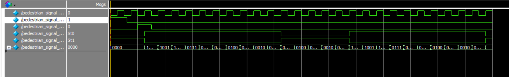

# Module 1: Pedestrian Signal Controller (FSM)

A Verilog HDL implementation of a pedestrian crossing signal using a Finite State Machine (FSM), built as part of the ElevanceSkills Verilog course. This is the first module of the larger **AI-inspired Traffic Signal Controller** project.

## Overview

The module models a pedestrian signal with a push-button trigger. When idle, the signal shows "Don't Walk." Pressing the button starts a 10-second Walk phase, followed by a 5-second Don't Walk phase, then cycles continuously between Walk and Don't Walk.

## States

| State        | Encoding | walk_signal | dont_walk |
|--------------|----------|-------------|-----------|
| IDLE         | 2'b00    | 0           | 1         |
| WALK         | 2'b01    | 1           | 0         |
| DONT_WALK    | 2'b10    | 0           | 1         |

## I/O Ports

| Port          | Direction | Width | Description                          |
|---------------|-----------|-------|---------------------------------------|
| clk           | input     | 1     | System clock                          |
| reset         | input     | 1     | Asynchronous active-high reset        |
| btn_press     | input     | 1     | Pedestrian push-button                |
| walk_signal   | output    | 1     | High when "Walk" is displayed         |
| dont_walk     | output    | 1     | High when "Don't Walk" is displayed   |
| countdown     | output    | 4     | Countdown timer value                 |

## Behavior

- On reset, the FSM goes to **IDLE** with `dont_walk = 1`.
- A button press moves the FSM to **WALK** with a 10-count timer.
- When the WALK countdown reaches 0, it transitions to **DONT_WALK** with a 5-count timer.
- The FSM then cycles continuously between WALK and DONT_WALK.

## Testbench

`pedestrian_signal_tb.v` applies reset, then triggers `btn_press`, and uses `$monitor` to log signal transitions over time. Simulated in **ModelSim/QuestaSim**.

### Waveform



## How to Simulate (ModelSim/QuestaSim)
``` vlog pedestrian_signal.v pedestrian_signal_tb.v vsim pedestrian_signal_tb run -all ```

## Notes

Currently, once a button is pressed, the FSM cycles continuously between WALK and DONT_WALK rather than returning to IDLE. This may be revised in a future iteration to better reflect real-world behavior between pedestrian requests.
