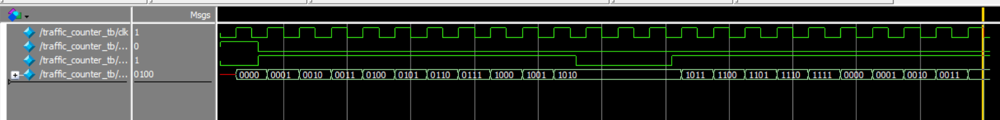
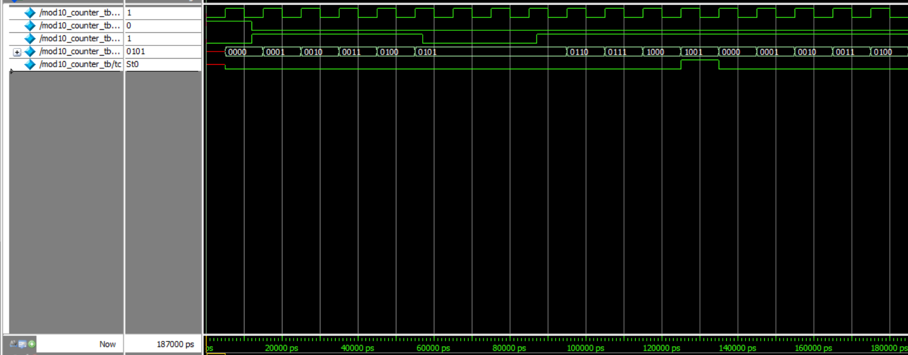
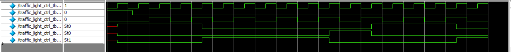
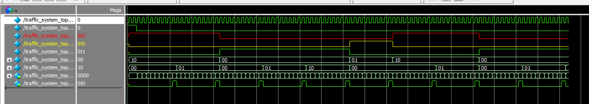

# Module 2: Sequential Logic — Counters & Traffic Light Controller

A set of Verilog HDL modules covering sequential logic design — synchronous counters, a modulo-10 counter with terminal count detection, and a traffic light controller driven by that counter. Built as part of the ElevanceSkills Verilog course (Assignment 12: Sequential Logic). This is the second module of the larger **AI-inspired Traffic Signal Controller** project.

## Overview

This module implements three building blocks that combine into a working traffic light system:

1. **`traffic_counter`** — a simple 4-bit synchronous up-counter with enable.
2. **`mod10_counter`** — a modulo-10 counter (0–9) with a terminal count (`tc`) output, used as the timing base for the light sequence.
3. **`traffic_light_ctrl`** — a 3-state FSM (RED → GREEN → YELLOW → RED) that advances on each `tc` pulse from the counter.
4. **`traffic_system_top`** — the top-level wrapper that wires `mod10_counter` into `traffic_light_ctrl` to form the complete system.

> **Note:** The assignment's stretch goal (frequency divider for a 100 MHz → 1 Hz clock) was intentionally not implemented for this module.

## 1. `traffic_counter` — 4-bit Synchronous Up-Counter

### I/O Ports

| Port    | Direction | Width | Description                       |
|---------|-----------|-------|------------------------------------|
| clk     | input     | 1     | System clock                       |
| reset   | input     | 1     | Synchronous active-high reset      |
| enable  | input     | 1     | Counts up on each clock when high  |
| count   | output    | 4     | Current count value                |

### Behavior

On reset, `count` goes to 0. When `enable` is high, `count` increments every clock edge and wraps naturally on overflow (no explicit rollover logic — relies on 4-bit wraparound). When `enable` is low, the count holds its value.

### Waveform



## 2. `mod10_counter` — Modulo-10 Counter with Terminal Count

### I/O Ports

| Port    | Direction | Width | Description                                |
|---------|-----------|-------|----------------------------------------------|
| clk     | input     | 1     | System clock                                 |
| reset   | input     | 1     | Synchronous active-high reset                |
| enable  | input     | 1     | Counts up on each clock when high            |
| count   | output    | 4     | Current count value (0–9)                    |
| tc      | output    | 1     | High when count == 9 (terminal count pulse)  |

### Behavior

Counts from 0 to 9, then wraps back to 0. The `tc` output goes high for one cycle when `count == 9`, acting as the "tick" signal consumed by `traffic_light_ctrl`. Holds its value when `enable` is low.

### Waveform



## 3. `traffic_light_ctrl` — Traffic Light FSM

### States

| State        | Encoding | red | yellow | green |
|--------------|----------|-----|--------|-------|
| RED_STATE    | 2'b10    | 1   | 0      | 0     |
| GREEN_STATE  | 2'b00    | 0   | 0      | 1     |
| YELLOW_STATE | 2'b01    | 0   | 1      | 0     |

### I/O Ports

| Port    | Direction | Width | Description                          |
|---------|-----------|-------|----------------------------------------|
| clk     | input     | 1     | System clock                           |
| reset   | input     | 1     | Synchronous active-high reset          |
| tc      | input     | 1     | Terminal count pulse from mod10_counter|
| red     | output    | 1     | High when red light is on              |
| yellow  | output    | 1     | High when yellow light is on           |
| green   | output    | 1     | High when green light is on            |

### Behavior

The FSM advances only on a `tc` pulse (not every clock cycle), using `elapsed_ticks` to count how many `tc` pulses have occurred in the current state:

- **RED** holds for 2 ticks, then moves to GREEN
- **GREEN** holds for 3 ticks, then moves to YELLOW
- **YELLOW** holds for 1 tick, then moves to RED

On reset, the FSM starts in RED_STATE.

### Waveform



## 4. `traffic_system_top` — Top-Level Integration

Wires `mod10_counter` (as the timing base, always enabled) into `traffic_light_ctrl` (as the light sequencer), so the full red → green → yellow → red cycle runs entirely off the internal `tc` pulses.

### I/O Ports

| Port    | Direction | Width | Description             |
|---------|-----------|-------|---------------------------|
| clk     | input     | 1     | System clock               |
| reset   | input     | 1     | Synchronous active-high reset |
| red     | output    | 1     | Red light output           |
| yellow  | output    | 1     | Yellow light output        |
| green   | output    | 1     | Green light output         |

### Waveform



## Testbenches

Each module has its own testbench (`traffic_counter_tb.v`, `mod10_counter_tb.v`, `traffic_light_ctrl_tb.v`, `traffic_system_top_tb.v`), each applying reset, exercising the enable/tc behavior, and using `$monitor` to log signal transitions. Simulated in **ModelSim/QuestaSim**.

## How to Simulate (ModelSim/QuestaSim)

```
 vlog traffic_counter.v mod10_counter.v traffic_light_ctrl.v traffic_system_top.v traffic_system_top_tb.v
sim traffic_system_top_tb
run -all
```
